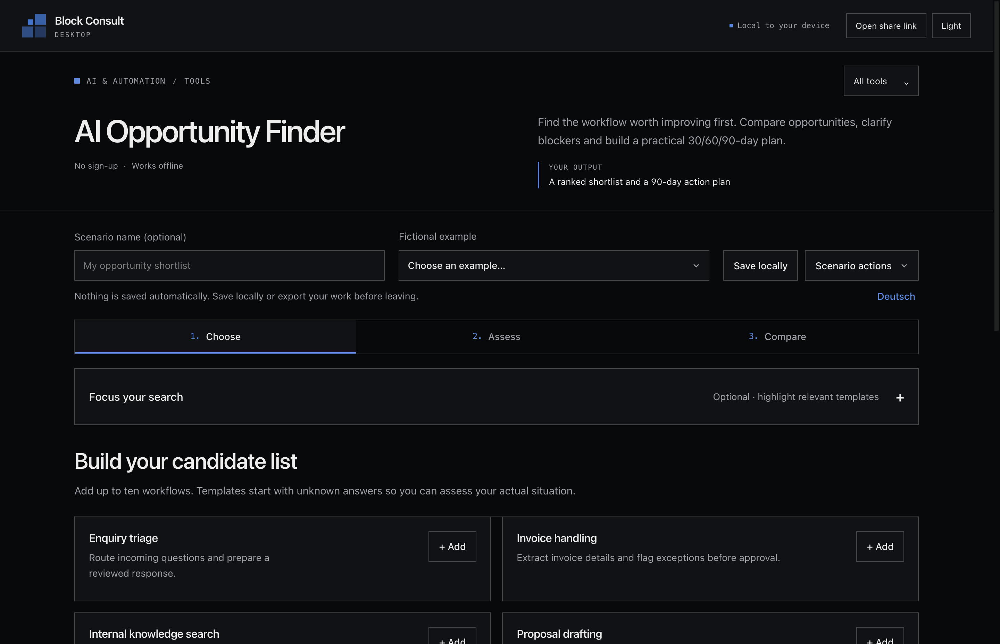
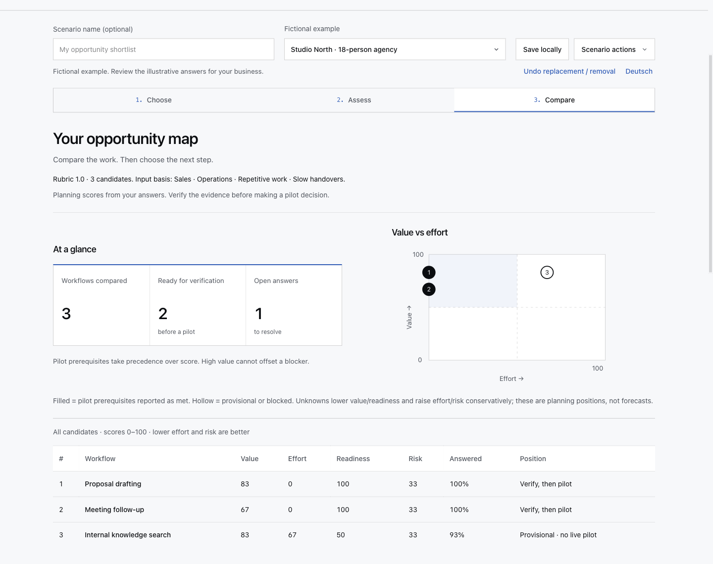

<a href="https://www.blockconsult.org">
  <picture>
    <source media="(prefers-color-scheme: dark)" srcset="public/blockconsult-logo.png">
    
  </picture>
</a>

# AI Opportunity Finder

Choose which recurring workflow to improve first. Compare up to ten opportunities using your answers about business value, implementation effort, readiness and risk, then review a ranked shortlist and a 30/60/90-day plan.

An offline desktop tool from [Block Consult](https://www.blockconsult.org), available in English and German, with light and dark themes.

[](https://github.com/blockconsult-org/ai-opportunity-finder/releases/latest) [](LICENSE) · [Platform builds](https://github.com/blockconsult-org/ai-opportunity-finder/actions/workflows/release.yml)

**[Download for macOS or Windows](https://github.com/blockconsult-org/ai-opportunity-finder/releases/latest)** · [Use in your browser](https://www.blockconsult.org/tools/ai-opportunity-finder) · [Report an issue](https://github.com/blockconsult-org/ai-opportunity-finder/issues)



## What you can do

- Build a shortlist from workflow templates or add a custom workflow, with optional business-function and pain-point filters.
- Record owners, evidence and answers for each candidate. Unknown answers stay visible and make the assessment more conservative.
- Compare value, effort, readiness and risk on a chart and ranked table. Pilot prerequisites take precedence over a high score.
- Review the top three candidates, their blockers, open questions, suggested pilot metrics and 30/60/90-day next steps.
- Save an editable JSON model, export a PNG summary or PDF, or share a readable snapshot.

## Get started

1. Choose a **Fictional example**, such as **Studio North · 18-person agency**, or add workflows in **Choose**.
2. Use **Assess** to replace illustrative answers with your own evidence, owners and constraints.
3. Open **Compare** to review the opportunity map and shortlist. Resolve blockers before treating a candidate as ready for a pilot.
4. Choose **Save locally** or **Scenario actions → Export JSON** to keep your work.

## Screenshots



The built-in Studio North example compares three workflows. Filled and hollow chart markers distinguish candidates whose reported prerequisites are met from provisional or blocked ones. Both screenshots show the actual desktop app with fictional example data or its starting workspace.

## Download and install

| Platform | Download | Installation |
| --- | --- | --- |
| macOS, Apple silicon and Intel | Universal `.dmg` | Open the disk image and drag the app to Applications. |
| Windows 11, Intel/AMD 64-bit | `windows-x64-setup.exe` | Run the per-user installer; administrator rights are not required. |
| Windows, portable | `windows-x64-portable.exe` | Run directly without installing. |

Release notes state the signing and notarization status of each download. Unsigned Windows releases may show a publisher warning. macOS requires macOS 13 or later. Check `SHA256SUMS.txt` against the downloaded file using `shasum -a 256` (macOS) or `Get-FileHash -Algorithm SHA256` (PowerShell). Download only from this repository's Releases page.

## Your data

Calculations and editing run locally without an internet connection, account or API key. The app has no analytics, telemetry, cloud synchronization or automatic uploads.

Use **Save locally** to save the current draft in this app, or **Scenario actions → Export JSON** for a portable copy. Changes are not saved automatically. Shared snapshots open read-only; choose **Make a copy** to edit one. Your saved draft changes only when you explicitly save.

JSON models and browser share links are compatible with the Block Consult browser tool. **Open share link** lets you inspect a shared scenario in the desktop app. Save or export before opening a share link; navigation replaces the open workspace. Share links contain readable, encoded snapshots and are not encrypted. Review the sharing preview and the option to include authored text before creating one.

Exports use native file-save dialogs. **File → Save report as PDF** saves a local PDF. Website and evidence links open in your default browser; unknown evidence destinations require confirmation.

## Run from source

Install Node.js 24 or newer, then:

```sh
git clone https://github.com/blockconsult-org/ai-opportunity-finder.git
cd ai-opportunity-finder
npm ci
npm run build
npm start
```

`npm run dev` runs the renderer in a browser. `npm test` checks the model and desktop security boundaries. `npm run test:desktop` launches real Electron and exercises offline rendering, themes, localization, exports and isolation. Run `npm run build` first.

```sh
npm run verify
npm run dist -- --mac --universal  # on macOS
npm run dist -- --win --x64       # on Windows
```

## Project layout

| Path | Responsibility |
| --- | --- |
| `tools/ai-opportunity-finder/` | Models, calculations, localized copy, UI and exports |
| `src/` | Desktop frame and small browser-framework adapters |
| `desktop/` | Sandboxed Electron host, local asset protocol, native PDF saving |
| `tests/` | Calculation regressions and real desktop integration checks |
| `.github/workflows/release.yml` | Tests and platform builds; draft releases for version tags |

## Release and maintenance

See the [release instructions](docs/RELEASING.md). Releases are manual downloads; the app does not silently update. Keep the Electron runtime current when maintaining a fork.

The scores are planning judgments derived from your answers, not forecasts of financial return or proof that a workflow is safe to automate. Verify evidence and pilot prerequisites with the responsible owner.

## Contributing and license

Read the [contribution guide](CONTRIBUTING.md) before opening a pull request. Report vulnerabilities privately through the [security policy](SECURITY.md).

[MIT](LICENSE) · Copyright © 2026 Block Consult GmbH. The license covers the code; it does not grant rights to use Block Consult’s name or logo as an endorsement.
